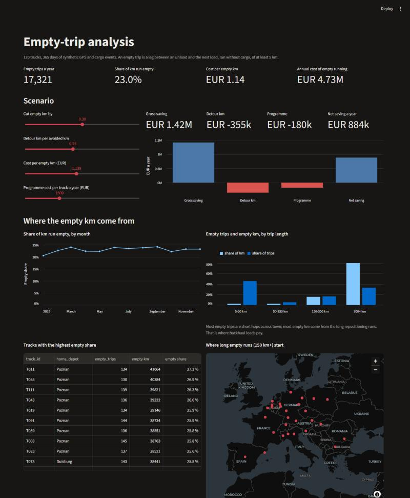
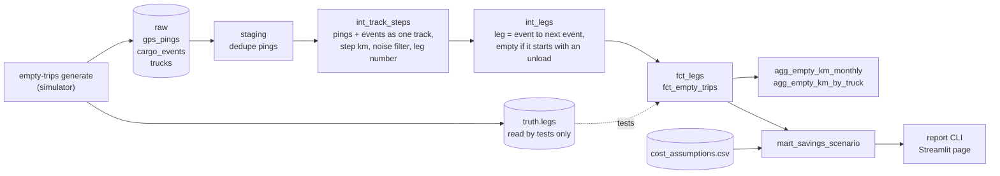

# empty-trip-analysis

How many trips does a truck fleet run empty, what does that cost a year, and what would
cutting it by 30% really save? This repo answers that with SQL from raw GPS pings and cargo
events, on a synthetic year of a 120-truck European fleet.

| | |
| --- | --- |
| **Question** | How much does empty running cost the fleet, and what does a 30% cut save after its costs? |
| **Data** | 2.5M GPS pings and 37,612 load/unload events for 120 trucks over 2025 (synthetic, see below). Nothing in it says "empty". |
| **Method** | Split each truck's track into legs between cargo events. A leg that starts with an unload runs empty. Distance comes from GPS, with parked-truck noise filtered out. An empty leg of 5 km or more is an empty trip. |
| **Check** | The simulator's ground truth is kept apart from the models. Tests require the detected legs to match it exactly, and at least 99.9% of legs to match on km within 3% (or 2 km on short legs). |
| **Assumptions** | Cost per empty km EUR 1.139 (fuel 0.434, tolls 0.18, tyres/maintenance 0.09, driver 0.435). Each avoided km needs 0.25 km of detour. Programme cost is EUR 1,500 per truck a year. All in [one file](dbt/seeds/cost_assumptions.csv). |
| **Result** | **17,321 empty trips a year, 23.0% of all km, costing EUR 4.73M a year. A 30% cut saves EUR 1.42M gross and EUR 885k net** (after EUR 355k of detours and EUR 180k programme cost). |



The numbers above come from `empty-trips report` after a full run with the default settings.

## Why synthetic data

This is a public, synthetic-data version of an empty-trip analysis I did for a logistics
company (details anonymized). That analysis found 14,987 empty trips and EUR 12M of annual
loss exposure, and modelled a 30% reduction worth EUR 1.8M net. The company data stays with
the company.

This repo builds the same kind of analysis on a simulator. I did **not** tune it to
reproduce those numbers. I
calibrated it to a public benchmark instead: Eurostat reports that empty vehicles covered
21.8% of EU road freight vehicle-km in 2025
([Road freight transport by journey characteristics](https://ec.europa.eu/eurostat/statistics-explained/index.php?title=Road_freight_transport_by_journey_characteristics)).
The simulated fleet runs 23.0% of its km empty.

## Run it

```bash
cp .env.example .env              # set a password
docker compose up -d --wait       # PostgreSQL 17
uv sync --all-groups
set -a; . ./.env; set +a          # export PG* for the tools below

uv run empty-trips generate       # 120 trucks, 2025, seed 7: about a minute
uv run dbt build                  # 11 models, 39 tests (detection checked against ground truth)
uv run empty-trips report         # the result above
uv run streamlit run app/app.py   # the page in the screenshot
```

`empty-trips generate --trucks 20 --days 90 --seed 3` makes a smaller or different fleet. A
run always replaces the previous data, so the same seed always gives the same result.

## How it works



**The simulator** ([generate.py](src/empty_trips/generate.py)) dispatches each truck through
28 European cities, one full truckload at a time:

- After a delivery, the next load is in the same city 55% of the time. That means a short
  empty hop across town.
- Otherwise the next load is in a nearby city, so the truck repositions empty.
- Every two to three weeks a truck goes back to its home depot.
- Trucks drive Monday to Friday, 05:00 to 19:00, at most 9 hours a day. Routes bend through
  two offset waypoints.

The feed carries the noise a real one has:

- position jitter of 10 to 15 m
- 1% of pings lost
- 0.5% of pings repeated (12,519 duplicates in the default run)
- hourly pings while parked

**Detection** happens in [int_track_steps](dbt/models/intermediate/int_track_steps.sql) and
[int_legs](dbt/models/intermediate/int_legs.sql):

1. Pings and cargo events go onto one timeline per truck. Events carry the position of the
   load or unload, so they count as position fixes too. When the ping at the moment of an
   unload is lost, the distance still splits correctly between the two legs. An earlier
   version without this booked 9 km of a loaded leg to the next empty leg.
2. A running count of events numbers the legs. Each step belongs to the leg in progress
   where the step started.
3. Steps shorter than 0.15 km count as zero. This removes 21,538 km of parked-truck jitter
   that would otherwise look like driving.
4. A leg that starts with an unload is empty, and one that starts with a load is loaded.
   These legs are left out:
   - each truck's last leg, which has no closing event yet
   - the distance before a truck's first event
5. Empty legs shorter than 5 km are moves within a yard, not trips (`min_empty_trip_km`).

**How good the detection is**, measured against ground truth for all 37,492 legs:

- Leg boundaries and empty/loaded labels match exactly. No leg is missing or extra.
- The mean per-leg distance error is 0.08%, and fleet-wide km are within 0.004%.
- 5 legs are off by more than 3% (or 2 km on short legs). All are short, slow, winding legs,
  where pings 10 minutes apart cut corners and read short. Real GPS does the same. The test
  allows at most 0.1% of legs outside the band.

**The cost model** ([mart_savings_scenario](dbt/models/marts/mart_savings_scenario.sql)):

```
cost per empty km = fuel (L/100km x EUR/L) + tolls + tyres/maintenance + driver EUR/h / avg speed
annual empty km   = empty-trip km in the period, scaled to 365 days
gross saving      = annual empty km x 30% x cost per empty km
detour cost       = annual empty km x 30% x 0.25 x cost per empty km
programme cost    = trucks x EUR 1,500     (load boards, planner time)
net saving        = gross - detour - programme
```

These are stated assumptions for a generic EU long-haul fleet, not measured costs. Edit
[cost_assumptions.csv](dbt/seeds/cost_assumptions.csv) and run `dbt build`, or move the
sliders on the page. Revenue from backhaul loads is left out on purpose: it would make the
case look better, but it depends on freight rates the data does not have.

**What the result says.**

- 46% of empty trips are under 50 km, but they add up to only 2% of empty km.
- 80% of empty km come from repositioning runs of 300 km or more.
- So a 30% cut has to come from finding backhaul loads for the long runs. That is why the
  scenario charges a detour and a programme cost.

## Tests

`dbt build` runs 39 data tests, among them:

- `assert_legs_match_truth`: every leg, its start and end, and its kind match the simulator
  exactly
- `assert_leg_km_close_to_truth`: at least 99.9% of legs within 3% / 2 km
- `assert_empty_km_total_matches_truth`: fleet empty km within 0.5%
- `assert_filtered_km_not_above_raw`: the noise filter only ever removes distance
- keys, relationships and accepted values on every model, and no two loads or two unloads
  in a row

`pytest` covers the simulator:

- determinism
- a truck's data does not depend on fleet size
- events alternate between load and unload
- driving-time rules
- the empty share is in a realistic range
- a rerun replaces the data

[CI](.github/workflows/ci.yml) runs lint, pytest, a 20-truck year, `dbt build`, the report,
and a headless render of the Streamlit page.

## Layout

```
src/empty_trips/   simulator (generate.py), loader (load.py), CLI (cli.py)
dbt/               staging -> intermediate -> marts, cost assumptions seed, truth tests
app/app.py         Streamlit page over the marts
scripts/           headless app check used by CI
tests/             simulator and loader tests
```

MIT licensed.
